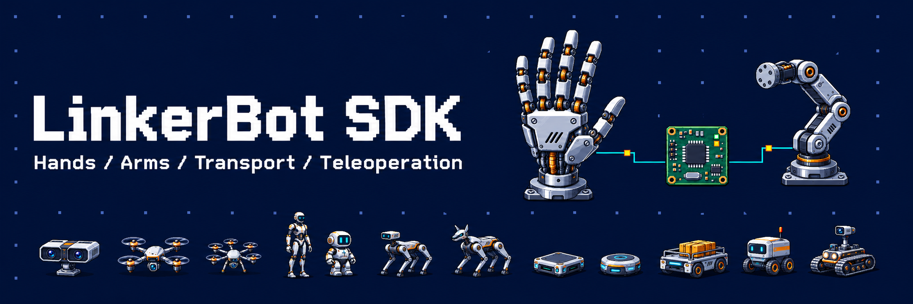

# LinkerBot SDKs

SDKs, communication libraries, and teleoperation tools for LinkerBot hands and arms.
This repository is a project directory; install and build software from the linked repositories.

English | [简体中文](README.zh-CN.md)

## Choose a project

- **Hand control:** use the C++ or Python hand SDK. Use the Hand ROS 2 SDK for ROS topics and services.
- **Arm control:** use the Arm Python SDK or Arm ROS 2 SDK.
- **Teleoperation:** use `linkerhand-telop-ros2` for glove-to-hand retargeting, or `linkerbot-teleop-arm` to read a dual-arm input device.
- **Transport integration:** use the C++ or Python transport library for communication without device control APIs.
- **Existing deployments:** check the legacy section before changing SDKs.

Maintenance categories below follow the SDK directory's maintenance plan as of **2026-11-06**.
They do not imply that a repository is archived. Supported models, firmware, adapters,
platforms, and installation requirements are defined by each project's documentation.

## Maintained projects

### Communication libraries

- [**linkerbot-transport-cpp**](https://github.com/linker-bot/linkerbot-transport-cpp) — C++17 communication library with CAN/CAN FD backends, shared connections, frame routing, and send receipts. Optional serial and Modbus RTU modules are documented in the current source; availability depends on the chosen release. Device protocols and motion control belong in the device SDK.
- [**linkerbot-transport**](https://github.com/linker-bot/linkerbot-transport) — Python communication layer for Classic CAN and CAN FD. Provides receive routing, shared connection management, send results, and transmit scheduling independently of ROS and device models.

### C++ SDKs and tools

- [**linkerbot-hand-cpp-sdk**](https://github.com/linker-bot/linkerbot-hand-cpp-sdk) — C++17 hand SDK for discovery, joint control, sensor reads, and background telemetry, using `linkerbot-transport-cpp`. Consult its model capabilities and compatibility guides before selecting hardware.
- [**linkerbot-hand-tools**](https://github.com/linker-bot/linkerbot-hand-tools) — Shared CLI/TUI and Web tools for the modern and legacy C++ hand SDKs, with offline simulation, telemetry and tactile/palm visualization. Hardware operation requires the corresponding SDK and adapter runtimes.
- [**linkerbot-teleop-arm**](https://github.com/linker-bot/linkerbot-teleop-arm) — Reads 14 joints from a dual-arm input device over Linux SocketCAN. Provides a C++17 core library, CLI, and ROS 2 node. This is an input-device reader, not the robotic arm motion-control SDK.

### Python and ROS 2 SDKs

- [**linkerbot-hand-python-sdk**](https://github.com/linker-bot/linkerbot-hand-python-sdk) — Python hand SDK for connecting to devices, reading state, and controlling hands through the shared Python transport library. Start with its source installation and connection guides.
- [**linkerbot-hand-ros2-sdk**](https://github.com/linker-bot/linkerbot-hand-ros2-sdk) — ROS 2 hand integration with typed messages and services, a Lifecycle driver, and an O6 URDF slider GUI. Uses the Hand Python SDK and transport library; see its Humble/Jazzy setup instructions.
- [**linkerbot-arm-python-sdk**](https://github.com/linker-bot/linkerbot-arm-python-sdk) — Python SDK for A7, A7lite, P7, and H75 arms, with joint control, feedback, and forward/inverse kinematics. See the project documentation for Pinocchio and transport requirements.
- [**linkerbot-arm-ros2-sdk**](https://github.com/linker-bot/linkerbot-arm-ros2-sdk) — ROS 2 topics and services for left and right A7, A7 Lite, and P7 arms, built on the Arm Python SDK. Follow its startup guide: default configuration enables and homes the arm at startup.
- [**linkerhand-telop-ros2**](https://github.com/linker-bot/linkerhand-telop-ros2) — ROS 2 teleoperation and motion retargeting for supported data gloves and LinkerHand models. Includes glove adapters, model assets, configuration, and examples. Keep the documented source-workspace layout after building; copying only `install/` is not supported by the documented release.

## Legacy projects — maintenance ending

These repositories are retained for existing applications. Use maintained projects for
new development where the required hardware and features are supported. No end-of-maintenance
date is specified here. A listed successor is a starting point for evaluation, not a
drop-in replacement or a guarantee of model coverage.

- [**linkerbot-hand-legacy-cpp-sdk**](https://github.com/linker-bot/linkerbot-hand-legacy-cpp-sdk) — Legacy packaged C++ hand SDK with public headers, prebuilt libraries, callback adapters and one read-only integration example. Interactive tools now live in [linkerbot-hand-tools](https://github.com/linker-bot/linkerbot-hand-tools). The CMake package is `linkerhand-legacy-cpp-sdk` and its target is `LinkerHand::linkerhand_legacy_cpp_sdk`; prebuilt library filenames remain unchanged. Compatibility maintenance covers L7, G20 (L20_10/L20_11), L21, L25 and O20. Evaluate `linkerbot-hand-cpp-sdk` model by model before migrating.
- [**linkerbot-python-sdk**](https://github.com/linker-bot/linkerbot-python-sdk) — Earlier combined Python SDK with hand and arm functionality. Evaluate the separate Hand Python SDK, Arm Python SDK, and transport library for new integrations.
- [**linkerhand-python-sdk**](https://github.com/linker-bot/linkerhand-python-sdk) — Earlier Python hand SDK with CAN/Modbus configuration and control examples. Evaluate `linkerbot-hand-python-sdk`; verify device and protocol support first.
- [**linkerhand-ros2-sdk**](https://github.com/linker-bot/linkerhand-ros2-sdk) — Earlier ROS 2 hand driver with control examples, GUI tools, and tactile visualizations. Evaluate `linkerbot-hand-ros2-sdk` and check message, launch, and model differences.
- [**linkerhand-ros-sdk**](https://github.com/linker-bot/linkerhand-ros-sdk) — ROS 1 hand driver and functional examples. Moving to `linkerbot-hand-ros2-sdk` also requires a ROS 1 to ROS 2 application migration.
- [**linkerhand-l30-sdk**](https://github.com/linker-bot/linkerhand-l30-sdk) — L30-specific ROS 2 driver with CAN FD communication, GUI control, and optional tactile data. Check L30 protocol and feature coverage in the maintained hand SDKs before migrating.
- [**linkerhand-o20-ros2**](https://github.com/linker-bot/linkerhand-o20-ros2) — O20-specific ROS 2 driver and GUI examples using CAN FD. Confirm O20 support explicitly; support for O30 does not establish O20 compatibility.
- [**linkerhand-l20d-ros2**](https://github.com/linker-bot/linkerhand-l20d-ros2) — L20D-specific ROS 2 driver with GUI, hand-state topics, and tactile data. Confirm L20D support explicitly; similarly named L20 models are not sufficient evidence.
- [**linkerhand-cpp-ros2**](https://github.com/linker-bot/linkerhand-cpp-ros2) — ROS 2 wrapper around the legacy C++ hand SDK, with launch configuration and GUI tools. Evaluate the maintained Hand ROS 2 SDK's interfaces and model coverage before replacing it.
- [**linkerhand-ros-teleop**](https://github.com/linker-bot/linkerhand-ros-teleop) — Legacy glove retargeting project with ROS 1 and ROS 2 nodes and an offline Python core wheel. Its README documents UDP input from glove software. Evaluate `linkerhand-telop-ros2` for current ROS 2 teleoperation needs; model and interface compatibility must be checked.

Read the [legacy migration guide](MIGRATION.md) before replacing an existing SDK.

## Documentation and license

Each linked repository is the source for its own installation, API, hardware limits,
and release information. This directory does not distribute the SDKs or their drivers.
Its [Apache License 2.0](LICENSE) applies to this repository; linked projects have their own licenses.
